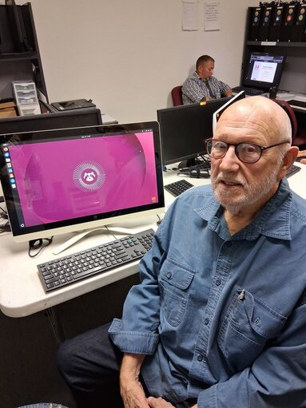
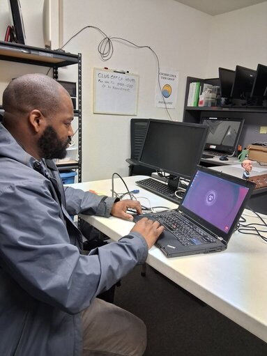
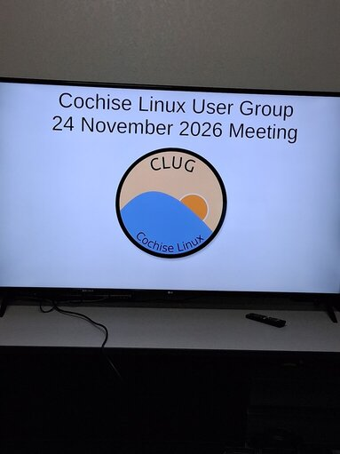
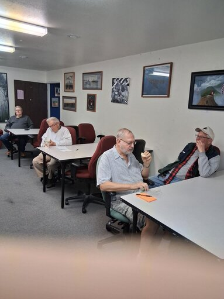
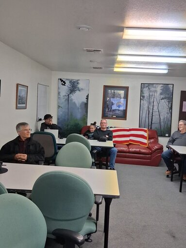
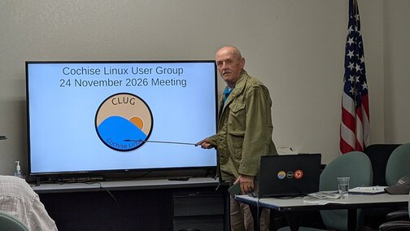

### Location: Warrior Healing Center, 1838 Paseo San Luis, Sierra Vista, AZ

### Date: Tuesday, 24 November 2026
### Meeting Minutes:

**Attendees:** 
 * There were 11 attendees.

**Upcoming CLUG events:**
 * 10 December, Ubuntu Hour, 1800-1900, Carl’s Jr, 2080 E. Fry Blvd.
 * 22 December, CLUG Linux Workshop, 1700-1830, Warrior Healing Center main conference room, 1838 Paseo San Luis
 * 14 January, Ubuntu Hour, 1800-1900, Carl’s Jr, 2080 E. Fry Blvd.
 * 26 January, CLUG Supper Meeting, 1700-1830, Chili's, 4001 E. Hwy 90
 * 11 February, Ubuntu Hour, 1800-1900, Carl’s Jr, 2080 E. Fry Blvd.
 * 23 February, CLUG Meeting, 1700-1830, Warrior Healing Center main conference room, 1838 Paseo San Luis

**Useful CLUG links:**
 * CLUG website:  https://cochiselinuxusergroup.org
 * CLUG FaceBook Page:  https://www.facebook.com/groups/1059259857477393/
 * CLUG Mailing List Archives: https://www.freelists.org/archive/cochiselinux
 * CLUG inventory of computers and spare parts & accessories:  https://cochiselinuxusergroup.org/inventory

**Announcements:**
 * To date we have donated 266 computers to individuals or groups.  This year we have donated 45.

 * This one went to Dale S.

 * This one went to Jalan W.
 * To date we have conducted 434 installs on laptop and desktop computers.  This year we have conducted 93.
 * We have 41 people on our mailing list, 60 people on our Facebook page.
 * We have 6 desktop computers ready for donation.

**Future Presentations:**
 * TBD, “LaTeX & TeXstudio” by George Self

**Presentation:**
 * “How to Prepare Linux Install Media for Your Computer” by Rex Bouwense 

**Discussion/Activities:**
 * A member asked why he had no sound on his laptop when he connected it to his TV and added speakers.  He was told to go to his sound settings and point to the speakers to get sound.
 * Discussed Allo vs Cox (Spectrum) with regard to internet speed and TV.  It was related that Allo is relatively faster because it runs fiber right to the house. Although Cox has fiber, it is to the street and copper wire in the house.  The one attendee that had already coverted to Allo was happy with his decision.
 * It was announced that members who would like to give a presentation should notify David or Rex so they could be scheduled.  Also if anyone would like a subject to be covered to notify David or Rex.
  
**Aftermath:**
 * Several of the attendees retired to Culver’s for some supper and additional Linux conversation.

